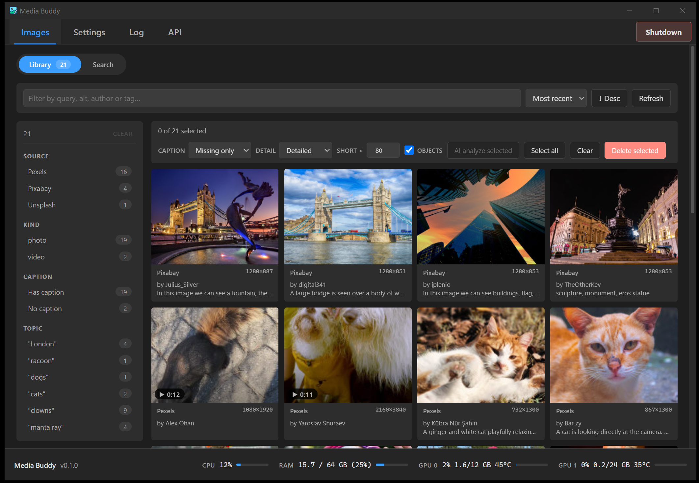
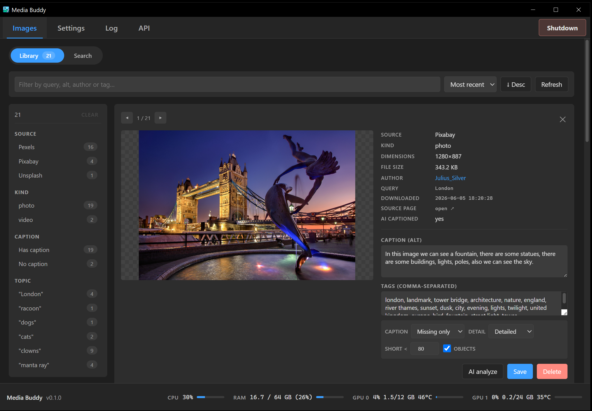
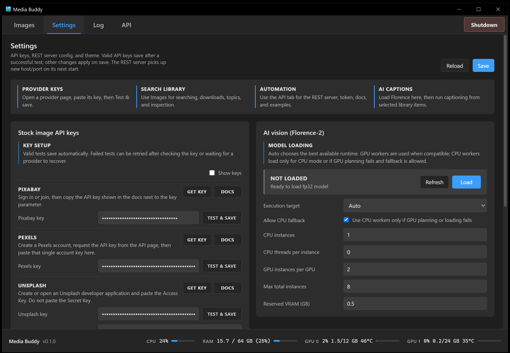
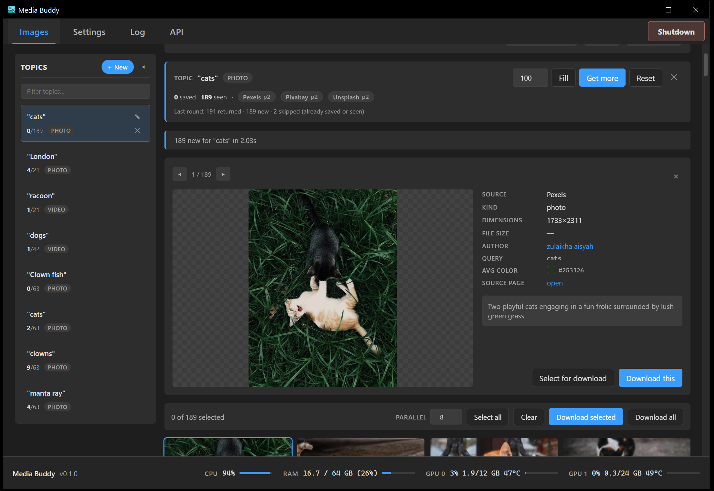
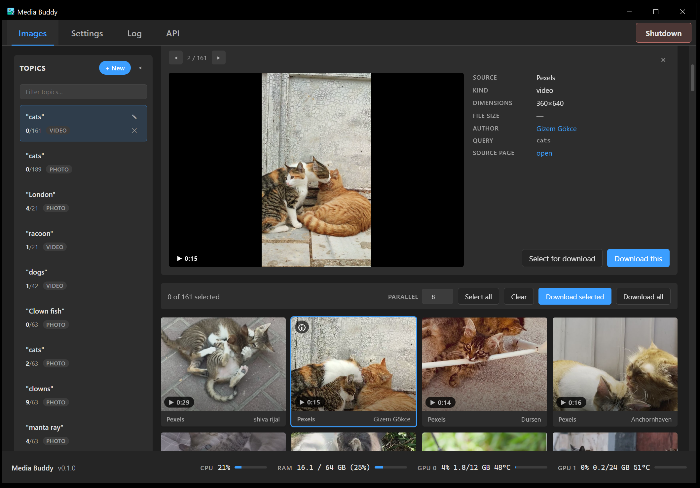
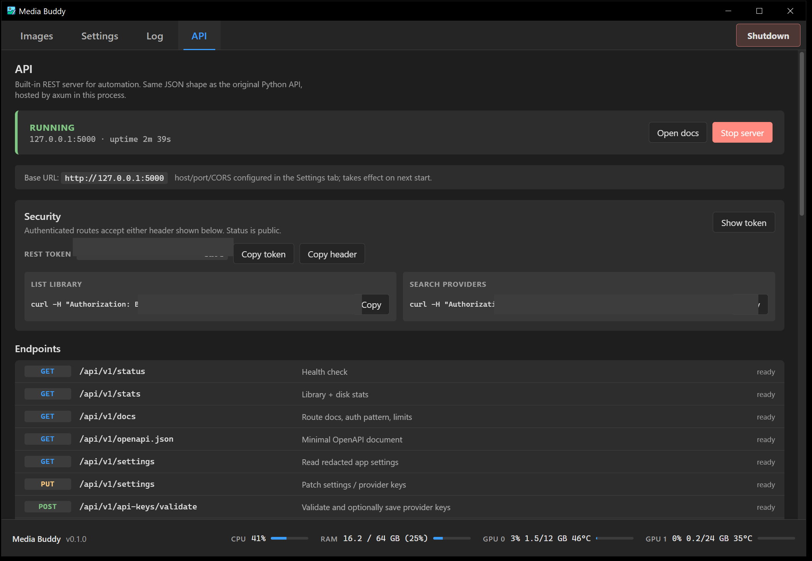

# Media Buddy

[](https://github.com/aivrar/mediabuddy/releases/latest)


**Portable Windows app to search, download, organize, preview, and AI-caption
stock photos and videos from Pixabay, Pexels, and Unsplash.**

Media Buddy is a native stock image downloader and local media library for
searching, downloading, organizing, previewing, tagging, and AI-captioning stock
photos and videos from Pixabay, Pexels, and Unsplash. It includes batch
downloads, provider metadata capture, a local REST API, and Florence-2 ONNX
computer vision for captions and object tags.

It is a Tauri 2 + SolidJS + Rust rewrite of the original Python ImageBuddy app.
There is no Python runtime requirement.

**Current version: [0.2.1](https://github.com/aivrar/mediabuddy/releases/tag/v0.2.1)** · [What's new](docs/RELEASE_NOTES_0.2.1.md) ·
[All releases](https://github.com/aivrar/mediabuddy/releases)

## Screenshots

| Search | Library | Settings |
| --- | --- | --- |
|  |  |  |

| Filters | Video Preview | API |
| --- | --- | --- |
|  |  |  |

## Highlights

- Multi-source search across Pixabay, Pexels, and Unsplash.
- Photo and video support, including preview posters for videos.
- Persistent search topics with per-provider cursors. Fetched results wait
  with the topic until you download or dismiss them.
- Batch downloads with concurrency controls. Videos stream straight to disk.
- Local library backed by SQLite WAL mode.
- Rich metadata capture where providers expose it.
- Large image/video inspector with editable caption and tags.
- Florence-2 ONNX AI vision for captions and object tags.
- Every caption records who wrote it (provider, AI, or typed by hand).
  Captions typed by hand, and captions whose origin is unknown, are protected
  from AI runs by default.
- A caption an AI run replaces is kept and can be restored.
- Dynamic GPU/CPU worker planning for Florence-2.
- Built-in REST API for automation with bearer-token security.
- Portable data folder beside the executable.

## Download And Run

Download version 0.2.1 from the
[v0.2.1 release page](https://github.com/aivrar/mediabuddy/releases/tag/v0.2.1):

| File | Use it for |
| --- | --- |
| [Media.Buddy_0.2.1_x64-setup.exe](https://github.com/aivrar/mediabuddy/releases/download/v0.2.1/Media.Buddy_0.2.1_x64-setup.exe) | Installer. Recommended for most people. |
| [Media.Buddy_0.2.1_x64_en-US.msi](https://github.com/aivrar/mediabuddy/releases/download/v0.2.1/Media.Buddy_0.2.1_x64_en-US.msi) | MSI package, for environments that prefer MSI. |
| [mediabuddy.exe](https://github.com/aivrar/mediabuddy/releases/download/v0.2.1/mediabuddy.exe) | Portable. No install; keeps its data beside the exe. |

The [latest release](https://github.com/aivrar/mediabuddy/releases/latest) link always points at the newest version.

When launched, the portable executable creates a sibling `data/` folder for
settings, downloads, logs, the SQLite library, and Florence-2 model/runtime
cache. If that folder cannot be written to (for example an install under
`C:\Program Files`), data goes to `%LOCALAPPDATA%\MediaBuddy\data` instead.

Upgrading: the library database is upgraded in place the first time a newer
version opens it. Going back to an older version afterwards is not supported,
so back up `data/` first if you may want to.

## First Run

1. Open **Settings**.
2. Use **Get key** beside Pixabay, Pexels, and Unsplash to create provider API
   keys.
3. Paste each key and press **Test & save**.
4. Open **Images -> Search** and run a query.
5. Select result cards and choose **Download selected** or **Download all**.
6. Open **Images -> Library** to inspect, tag, delete, or AI-caption saved
   media.

## AI Vision

Florence-2 is not bundled in the executable. When you press **Load**, Media
Buddy downloads the required ONNX model and runtime files into:

```text
data/models/
```

GPU workers are used when compatible. CPU workers are used only for CPU mode or
as fallback when GPU planning/loading fails.

## REST API

The API tab starts a local REST server, defaulting to:

```text
http://127.0.0.1:5000
```

Use the API tab to copy the bearer token, open live docs, and copy example curl
commands. The status endpoint is public; other `/api/v1/*` routes require the
token when one is configured.

## Documentation

- Wiki: [github.com/aivrar/mediabuddy/wiki](https://github.com/aivrar/mediabuddy/wiki)
  (source in [docs/wiki/Home.md](docs/wiki/Home.md))
- PDF-ready manual: [docs/MEDIA_BUDDY_MANUAL.md](docs/MEDIA_BUDDY_MANUAL.md)
- PDF export notes: [docs/PDF_EXPORT.md](docs/PDF_EXPORT.md)
- Screenshot checklist: [docs/wiki/Screenshot-Checklist.md](docs/wiki/Screenshot-Checklist.md)
- Release checklist: [docs/wiki/Release-Checklist.md](docs/wiki/Release-Checklist.md)
- Release notes: [0.2.1](docs/RELEASE_NOTES_0.2.1.md),
  [0.2.0](docs/RELEASE_NOTES_0.2.0.md),
  [0.1.0](docs/RELEASE_NOTES_0.1.0.md)
- Changelog: [CHANGELOG.md](CHANGELOG.md)
- Security policy: [SECURITY.md](SECURITY.md)

## Build From Source

Requirements:

- Windows 10 or 11
- Rust stable
- Node.js 20+
- Microsoft C++ Build Tools / Visual Studio 2022 Build Tools
- WebView2 Runtime, usually already present on Windows 10/11

```powershell
git clone https://github.com/aivrar/mediabuddy.git
cd mediabuddy
npm install
npm run tauri dev
npm run tauri build
```

Release executable:

```text
src-tauri/target/release/mediabuddy.exe
```

Installers:

```text
src-tauri/target/release/bundle/nsis/Media Buddy_0.2.1_x64-setup.exe
src-tauri/target/release/bundle/msi/Media Buddy_0.2.1_x64_en-US.msi
```

## Data Layout

```text
data/
|-- config/
|   `-- settings.json
|-- images/
|   |-- originals/
|   `-- thumbs/
|-- videos/
|   |-- originals/
|   `-- thumbs/
|-- logs/
|-- models/
|-- images.db
|-- images.db-shm
`-- images.db-wal
```

Override the data location with:

```powershell
$env:MEDIABUDDY_DATA_DIR = "D:\MediaBuddyData"
```

## Privacy

Media Buddy stores provider keys and the REST token locally in
`data/config/settings.json`. Downloads, metadata, logs, model files, and the
SQLite library stay local unless you share the folder yourself.

Search/download/API calls go to the configured providers and local REST API
clients. Florence-2 model/runtime downloads come from Hugging Face, Microsoft
ONNX Runtime, NuGet, and PyPI for cuDNN runtime files.

## License

MIT. See [LICENSE](LICENSE).
