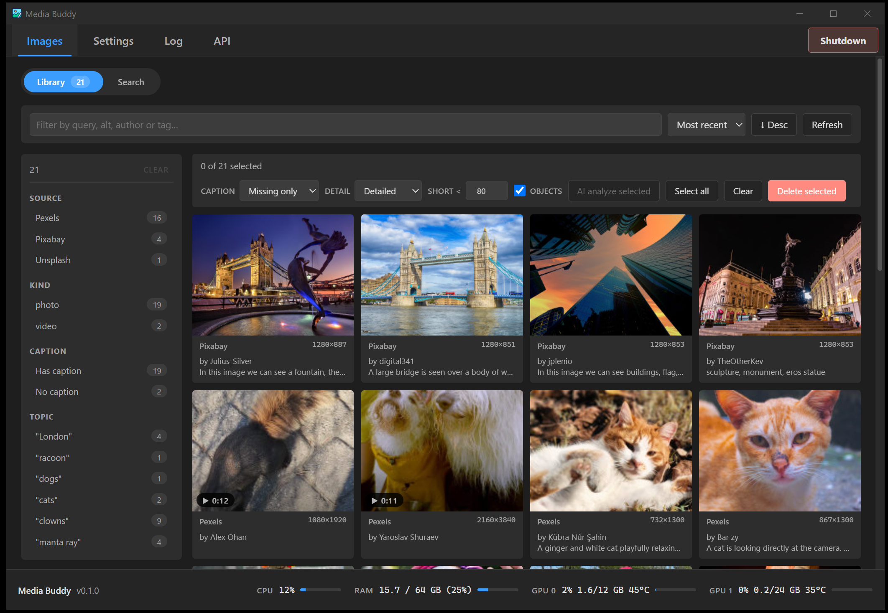
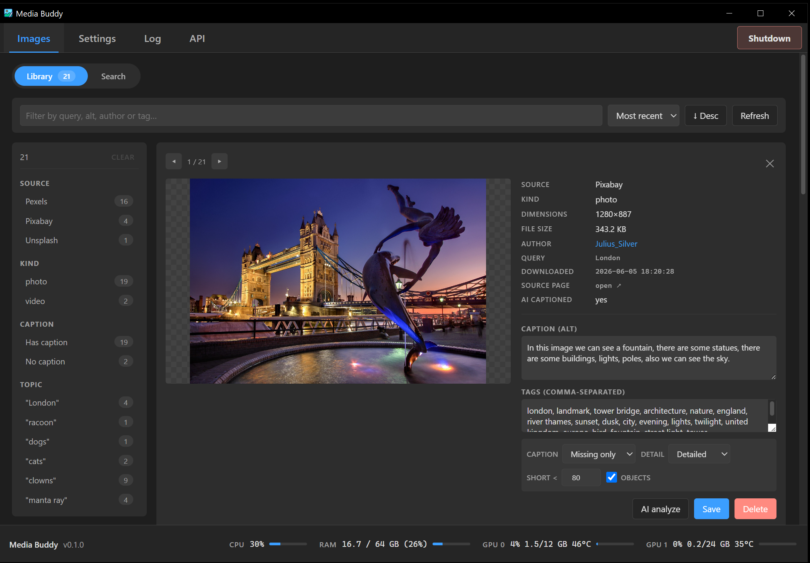
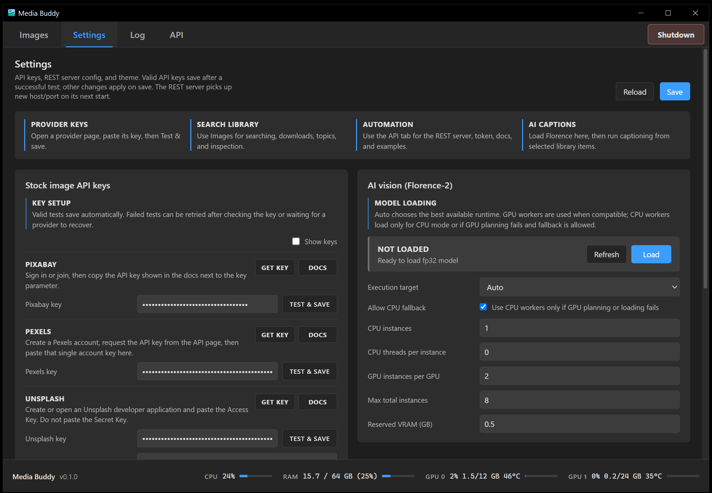

# Media Buddy Wiki

Media Buddy is a Windows desktop app for searching, downloading, organizing,
previewing, and AI-captioning stock photos and videos from Pixabay, Pexels, and
Unsplash.

The app is designed to run as a normal desktop tool or as a portable executable
with all app data stored beside the exe.

Current version: **0.2.1**. Download it from the
[v0.2.1 release page](https://github.com/aivrar/mediabuddy/releases/tag/v0.2.1), or see
[all releases](https://github.com/aivrar/mediabuddy/releases).

## Main Features

- Multi-source photo and video search.
- Persistent topics for repeat searches, with fetched results kept until you
  download or dismiss them.
- Fast single and batch downloads.
- Local library with editable captions and tags.
- Large image and video preview.
- Florence-2 ONNX AI vision for captions and object tags.
- Caption origin tracking (provider, AI, or typed by hand). Hand-typed
  captions and captions of unknown origin are protected from AI runs by
  default, and a caption an AI run replaces is kept and can be restored.
- Dynamic GPU/CPU vision worker planning.
- Local REST API for automation.
- Local settings, logs, models, and database.

## Wiki Pages

- [Getting Started](Getting-Started.md)
- [Installation And Portable Mode](Installation-and-Portable-Mode.md)
- [API Keys](API-Keys.md)
- [Search And Topics](Search-and-Topics.md)
- [Library And Downloads](Library-and-Downloads.md)
- [AI Vision Florence-2](AI-Vision-Florence-2.md)
- [REST API](REST-API.md)
- [Settings And Data](Settings-and-Data.md)
- [Screenshots](Screenshots.md)
- [Troubleshooting](Troubleshooting.md)
- [Screenshot Checklist](Screenshot-Checklist.md)
- [Release Checklist](Release-Checklist.md)

## Screenshots

| Search | Library | Settings |
| --- | --- | --- |
|  |  |  |

More screenshots are available on the [Screenshots](Screenshots.md) page.

## Manual

A single-file manual suitable for PDF export is included in the repository:

```text
docs/MEDIA_BUDDY_MANUAL.md
```

PDF export notes are included at:

```text
docs/PDF_EXPORT.md
```

To publish the GitHub Wiki, copy the files from `docs/wiki/` into the GitHub
Wiki repository for this project. In the wiki copy, page links drop the `.md`
ending and screenshot paths use `screenshots/` instead of `../screenshots/`.
